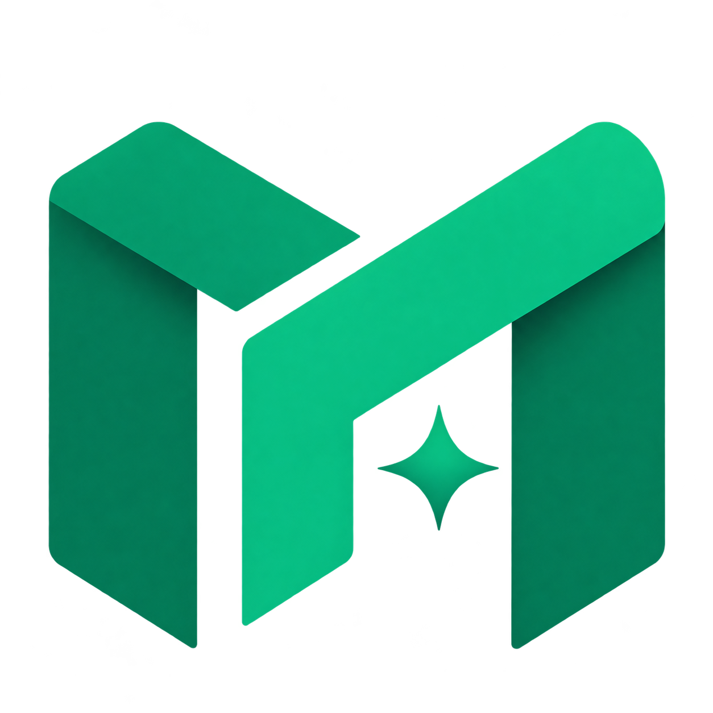

<div align="center">



# MetaForge

**Integrated software for data transformation, integration, and visualization**

---

[](https://opensource.org/licenses/Apache-2.0)


[](https://hub.docker.com/r/devliveorg/metaforge)


</div>

## What is MetaForge?

---

MetaForge is integrated software for data transformation, integration, and visualization. It supports a wide variety of data sources — relational databases, NoSQL databases, big data engines, message queues and file systems — and lets you manage multiple data sources, query and transform data, build datasets, and create charts and monitoring views.

## Features

---

- **Data source management** — connect, test and manage 50+ data sources from a single console
- **SQL query console** — IDE-style editor with syntax highlighting, formatting, execution history and export
- **Datasets** — build reusable datasets from tables or ad-hoc queries, preview data and define column metadata
- **Visualization** — drag-and-drop dashboards with tables, pies and more chart types
- **Reports** — schedule and share reports
- **Workflows** — chain data jobs into repeatable workflows
- **File storage** — read and write files through Aliyun OSS, Amazon S3, HDFS, local storage and more
- **Notifications** — DingTalk, email and other channels for job and system events
- **AI assistant** — chat with your data through configured AI providers
- **Plugin architecture** — every connector, converter and storage backend is a hot-loadable plugin
- **Administration** — users, roles, menus and runtime configuration with fine-grained permissions

## Requirements

---

| Dependency | Version                                      |
|:-----------|:---------------------------------------------|
| JDK        | 21                                           |
| Maven      | 3.9+ (wrapper `./mvnw` included)             |
| Node.js    | 20                                           |
| pnpm       | 9.13.2                                       |

## Getting Started

---

> Must-read for users: be sure to execute the following command after cloning the code locally

```bash
cp configure/git-hook/* .git/hooks
chmod 700 .git/hooks/*
```

### Run the backend (development)

Run the main class `org.devlive.metaforge.server.MetaForge` (module `core/metaforge-server`) from your IDE.
The server starts on [http://localhost:9096](http://localhost:9096). On first launch the setup wizard guides you through
selecting the metadata database (embedded H2 by default, or MySQL / PostgreSQL / SQL Server / Oracle) and creating the
administrator account.

### Run the frontend (development)

```bash
pnpm install
pnpm --filter metaforge-web dev
```

The web console starts on [http://localhost:3001](http://localhost:3001) and proxies API calls to the backend.

### Build for production

```bash
# Frontend
pnpm --filter metaforge-web build

# Backend + distribution package (the server serves the built frontend
# from core/metaforge-web/dist; the tarball lands in dist/)
./mvnw -T1C clean package -DskipTests
```

## Docker

---

```bash
docker pull devliveorg/metaforge:latest
docker run -d --name metaforge -p 9096:9096 devliveorg/metaforge:latest
```

Or unpack the distribution built locally (`dist/metaforge-server-2026.0.0-bin.tar.gz`) and run `bin/startup.sh`.

## Project Structure

---

```
metaforge
├── client                        # Command line client
├── configure                     # Default configuration and plugin manifests
├── core
│   ├── metaforge-captcha         # Captcha generation
│   ├── metaforge-common          # Shared utilities and enums
│   ├── metaforge-condor          # Scheduling integration
│   ├── metaforge-server          # Spring Boot server (REST API entry point)
│   ├── metaforge-service         # Domain services and persistence
│   ├── metaforge-security        # Security configuration
│   ├── metaforge-sql             # SQL statement builders
│   ├── metaforge-spi             # Plugin SPI contracts
│   ├── metaforge-web             # Vue 3 + Tailwind web console
├── convert                       # Data converters (JSON, CSV, XML, ...)
├── driver                        # Database drivers (Redis, MongoDB, ...)
├── executor                      # Execution engines
├── fs                            # File storage plugins (OSS, S3, local, ...)
├── lib                           # Shared libraries (HTTP client, logging, shell)
├── notify                        # Notification channels (DingTalk, ...)
├── parser                        # SQL parsers (MySQL, Trino, ...)
├── plugin                        # Data source plugins (50+ connectors)
├── scheduler                     # Job scheduling
└── shaded                        # Shaded third-party integrations
```

## Supported Connectors

---

MetaForge can query data from any SQL-speaking datastore or data engine (ClickHouse, MySQL, Presto and more).

Here are some of the major database solutions that are supported:

<div style="display: flex; flex-wrap: wrap; gap: 20px; justify-content: center;">
 <a href="https://clickhouse.com"></a>
 <a href="https://redis.io/"></a>
 <a href="https://www.postgresql.org/"></a>
 <a href="https://prestodb.io/"></a>
 <a href="https://www.mysql.com"></a>
 <a href="https://hive.apache.org/"></a>
 <a href="https://kyuubi.apache.org/"></a>
 <a href="https://druid.apache.org/"></a>
 <a href="https://www.elastic.co/"></a>
 <a href="https://trino.io/"></a>
 <a href="https://kylin.apache.org"></a>
 <a href="https://ignite.apache.org/"></a>
 <a href="https://www.ibm.com/db2/"></a>
 <a href="https://www.mongodb.com/"></a>
 <a href="https://www.dremio.com/"></a>
 <a href="https://www.monetdb.org/"></a>
 <a href="https://phoenix.apache.org/"></a>
 <a href="https://www.h2database.com/"></a>
 <a href="https://www.microsoft.com/sql-server"></a>
 <a href="https://www.oracle.com/"></a>
 <a href="https://crate.io/"></a>
 <a href="https://www.dameng.com/"></a>
 <a href="https://tdengine.com/"></a>
 <a href="https://impala.apache.org/"></a>
 <a href="https://www.oceanbase.com/"></a>
 <a href="https://neo4j.com/"></a>
 <a href="https://iotdb.apache.org/"></a>
 <a href="https://www.snowflake.com/"></a>
 <a href="https://ydb.tech/"></a>
 <a href="https://zookeeper.apache.org/"></a>
 <a href="https://duckdb.org/"></a>
 <a href="https://www.alibabacloud.com/product/oss"></a>
 <a href="https://kafka.apache.org"></a>
 <a href="https://ceresdb.io/"></a>
 <a href="https://greptime.com/"></a>
 <a href="https://questdb.io/"></a>
 <a href="https://doris.apache.org/"></a>
 <a href="https://www.starrocks.io/"></a>
 <a href="https://www.alibabacloud.com/product/hologres"></a>
 <a href="https://hadoop.apache.org/"></a>
 <a href="https://pinot.apache.org/"></a>
 <a href="https://cassandra.apache.org/"></a>
 <a href="https://matrixorigin.cn/"></a>
 <a href="https://www.scylladb.com/"></a>
 <a href="https://www.paradedb.com/"></a>
 <a href="https://www.timescale.com/"></a>
 <a href="https://solr.apache.org/"></a>
 <a href="https://www.influxdata.com/"></a>
 <a href="https://dolphindb.com/"></a>
</div>

## Documentation

---

[Extended documentation for MetaForge](https://metaforge.devlive.org)

## Join Us

---

Please visit [Issues 950](https://github.com/devlive-community/metaforge/issues/950)

## Thank you

---

[](https://www.jetbrains.com/)
[](https://www.rainbond.com/)
[](https://vuejs.org/)

## Stargazers over time

---

[](https://star-history.dera.page/#devlive-community/metaforge&Timeline)

## Contributors

---

<a href="https://github.com/EdurtIO/metaforge/graphs/contributors">
  
</a>
