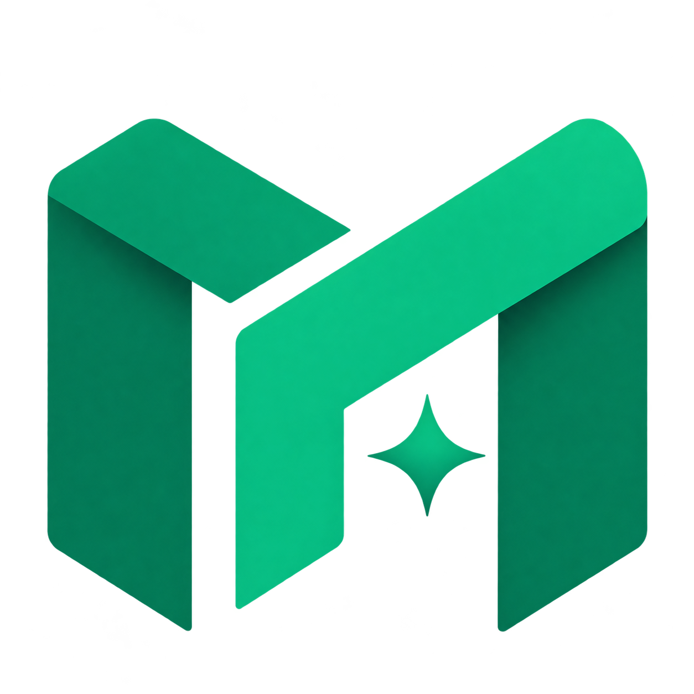

<div align="center">



# MetaForge

**Интегрированное программное обеспечение для преобразования, интеграции и визуализации данных**

---

[](https://opensource.org/licenses/Apache-2.0)


[](https://hub.docker.com/r/devliveorg/metaforge)


</div>

## Что такое MetaForge?

---

MetaForge — это интегрированное программное обеспечение для преобразования, интеграции и визуализации данных. Оно поддерживает самые разные источники данных — реляционные СУБД, NoSQL-базы данных, big data движки, очереди сообщений и файловые системы — и позволяет управлять множеством источников из единой консоли, запрашивать и преобразовывать данные, строить наборы данных, диаграммы и представления мониторинга.

## Возможности

---

- **Управление источниками данных** — подключение, проверка и управление 50+ источниками из единой консоли
- **SQL-консоль** — редактор в стиле IDE с подсветкой синтаксиса, форматированием, историей выполнения и экспортом
- **Наборы данных** — создание переиспользуемых наборов из таблиц или произвольных запросов, предпросмотр данных и метаданные столбцов
- **Визуализация** — дашборды с перетаскиванием: таблицы, круговые диаграммы и другие типы графиков
- **Отчёты** — планирование и совместный доступ к отчётам
- **Рабочие процессы** — объединение задач обработки данных в повторяемые workflow
- **Файловое хранилище** — чтение и запись файлов через Aliyun OSS, Amazon S3, HDFS, локальное хранилище и другие
- **Уведомления** — DingTalk, электронная почта и другие каналы для событий задач и системы
- **AI-ассистент** — общайтесь со своими данными через настроенных AI-провайдеров
- **Плагинная архитектура** — каждый коннектор, конвертер и хранилище являются подключаемыми плагинами
- **Администрирование** — пользователи, роли, меню и конфигурация среды выполнения с тонкой настройкой прав

## Требования

---

| Зависимость | Версия                            |
|:------------|:----------------------------------|
| JDK         | 21                                |
| Maven       | 3.9+ (в комплекте `./mvnw`)       |
| Node.js     | 20                                |
| pnpm        | 9.13.2                            |

## Быстрый старт

---

> Обязательно к прочтению: после клонирования кода обязательно выполните следующие команды

```bash
cp configure/git-hook/* .git/hooks
chmod 700 .git/hooks/*
```

### Запуск бэкенда (разработка)

Запустите главный класс `org.devlive.metaforge.server.MetaForge` (модуль `core/metaforge-server`) в своей IDE.
Сервер доступен на [http://localhost:9096](http://localhost:9096). При первом запуске мастер установки поможет выбрать
базу метаданных (по умолчанию встроенная H2, также MySQL / PostgreSQL / SQL Server / Oracle) и создать
учётную запись администратора.

### Запуск фронтенда (разработка)

```bash
pnpm install
pnpm --filter metaforge-web dev
```

Веб-консоль доступна на [http://localhost:3001](http://localhost:3001) и проксирует API-запросы к бэкенду.

### Сборка для продакшена

```bash
# Фронтенд
pnpm --filter metaforge-web build

# Бэкенд + дистрибутив (сервер отдаёт собранный фронтенд
# из core/metaforge-web/dist; архив попадает в dist/)
./mvnw -T1C clean package -DskipTests
```

## Docker

---

```bash
docker pull devliveorg/metaforge:latest
docker run -d --name metaforge -p 9096:9096 devliveorg/metaforge:latest
```

Либо распакуйте собранный локально дистрибутив (`dist/metaforge-server-2026.0.0-bin.tar.gz`) и запустите `bin/startup.sh`.

## Структура проекта

---

```
metaforge
├── client                        # Консольный клиент
├── configure                     # Конфигурация по умолчанию и манифесты плагинов
├── core
│   ├── metaforge-captcha         # Генерация капчи
│   ├── metaforge-common          # Общие утилиты и перечисления
│   ├── metaforge-condor          # Интеграция планировщика
│   ├── metaforge-server          # Сервер Spring Boot (точка входа REST API)
│   ├── metaforge-service         # Доменные сервисы и хранение данных
│   ├── metaforge-security        # Конфигурация безопасности
│   ├── metaforge-sql             # Конструкторы SQL-запросов
│   ├── metaforge-spi             # Контракты plugin SPI
│   ├── metaforge-web             # Веб-консоль Vue 3 + Tailwind
├── convert                       # Конвертеры данных (JSON, CSV, XML, ...)
├── driver                        # Драйверы баз данных (Redis, MongoDB, ...)
├── executor                      # Движки выполнения
├── fs                            # Плагины файловых хранилищ (OSS, S3, локальное, ...)
├── lib                           # Общие библиотеки (HTTP-клиент, логирование, shell)
├── notify                        # Каналы уведомлений (DingTalk, ...)
├── parser                        # SQL-парсеры (MySQL, Trino, ...)
├── plugin                        # Плагины источников данных (50+ коннекторов)
└── shaded                        # Shaded сторонние интеграции
```

## Поддерживаемые коннекторы

---

MetaForge может запрашивать данные из любого SQL-хранилища или движка данных (ClickHouse, MySQL, Presto и др.).

Ниже представлены некоторые из основных поддерживаемых решений для баз данных:

<div style="display: flex; flex-wrap: wrap; gap: 20px; justify-content: center;">
 <a href="https://clickhouse.com"></a>
 <a href="https://redis.io/"></a>
 <a href="https://www.postgresql.org/"></a>
 <a href="https://prestodb.io/"></a>
 <a href="https://www.mysql.com"></a>
 <a href="https://hive.apache.org/"></a>
 <a href="https://kyuubi.apache.org/"></a>
 <a href="https://druid.apache.org/"></a>
 <a href="https://www.elastic.co/"></a>
 <a href="https://trino.io/"></a>
 <a href="https://kylin.apache.org"></a>
 <a href="https://ignite.apache.org/"></a>
 <a href="https://www.ibm.com/db2/"></a>
 <a href="https://www.mongodb.com/"></a>
 <a href="https://www.dremio.com/"></a>
 <a href="https://www.monetdb.org/"></a>
 <a href="https://phoenix.apache.org/"></a>
 <a href="https://www.h2database.com/"></a>
 <a href="https://www.microsoft.com/sql-server"></a>
 <a href="https://www.oracle.com/"></a>
 <a href="https://crate.io/"></a>
 <a href="https://www.dameng.com/"></a>
 <a href="https://tdengine.com/"></a>
 <a href="https://impala.apache.org/"></a>
 <a href="https://www.oceanbase.com/"></a>
 <a href="https://neo4j.com/"></a>
 <a href="https://iotdb.apache.org/"></a>
 <a href="https://www.snowflake.com/"></a>
 <a href="https://ydb.tech/"></a>
 <a href="https://zookeeper.apache.org/"></a>
 <a href="https://duckdb.org/"></a>
 <a href="https://www.alibabacloud.com/product/oss"></a>
 <a href="https://kafka.apache.org"></a>
 <a href="https://ceresdb.io/"></a>
 <a href="https://greptime.com/"></a>
 <a href="https://questdb.io/"></a>
 <a href="https://doris.apache.org/"></a>
 <a href="https://www.starrocks.io/"></a>
 <a href="https://www.alibabacloud.com/product/hologres"></a>
 <a href="https://hadoop.apache.org/"></a>
 <a href="https://pinot.apache.org/"></a>
 <a href="https://cassandra.apache.org/"></a>
 <a href="https://matrixorigin.cn/"></a>
 <a href="https://www.scylladb.com/"></a>
 <a href="https://www.paradedb.com/"></a>
 <a href="https://www.timescale.com/"></a>
 <a href="https://solr.apache.org/"></a>
 <a href="https://www.influxdata.com/"></a>
 <a href="https://dolphindb.com/"></a>
</div>

## Документация

---

[Расширенная документация по MetaForge](https://metaforge.devlive.org)

## Присоединяйтесь к нам

---

Посетите [Issues 950](https://github.com/devlive-community/metaforge/issues/950)

## Благодарности

---

[](https://www.jetbrains.com/)
[](https://www.rainbond.com/)
[](https://vuejs.org/)

## История звёзд

---

[](https://star-history.dera.page/#devlive-community/metaforge&Timeline)

## Участники

---

<a href="https://github.com/EdurtIO/metaforge/graphs/contributors">
  
</a>
